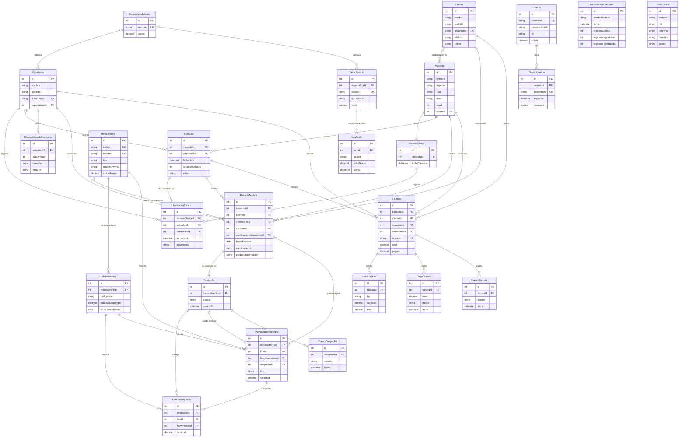

# Data Architecture & Persistence Layer

La capa de datos contiene 25 entidades persistidas en MySQL y usa Spring Data JPA con Hibernate. Los módulos clínicos, inventario, facturación y acceso comparten la misma base de datos; sus límites son lógicos, no servicios con almacenes independientes.

## Database Configuration

| Service/Module | DB Type | Profile | Driver | Connection | Migration Tool |
|---|---|---|---|---|---|
| Backend clínico | MySQL | `dev` (perfil activo por defecto) | MySQL Connector/J (`com.mysql.cj.jdbc.Driver`) | `localhost:3306/prueba` | No se encontró Flyway ni Liquibase |
| Backend clínico | MySQL | `prod` | MySQL Connector/J (`com.mysql.cj.jdbc.Driver`) | `localhost:3306/prueba` | No se encontró Flyway ni Liquibase |

En `dev`, Hibernate actualiza el esquema y se cargan datos de ejemplo mediante configuración Java. En `prod` no se declara una estrategia de DDL explícita. No se encontraron scripts de esquema ni migraciones versionadas. No se identificaron ajustes explícitos del pool de conexiones. Las credenciales se omiten.

Fuentes: `backend2026-80869/src/main/resources/application.properties`, `application-dev.properties`, `application-prod.properties`, `backend2026-80869/pom.xml` y `backend2026-80869/src/main/java/com/uniminuto/clinica/config/DatosInicialesConfig.java`.

## Data Ownership per Service

| Service | Tables Owned | ORM Framework | Caching | Notes |
|---|---|---|---|---|
| Pacientes y clientes | `cliente`, `mascota` | Spring Data JPA / Hibernate | No configurado | Relación opcional de mascota a cliente |
| Agenda e historia clínica | `consulta`, `disponibilidad_veterinario`, `historia_clinica`, `anotacion_clinica`, `veterinario`, `especialidad_medica` | Spring Data JPA / Hibernate | No configurado | Veterinarios y especialidades también son utilizados por tarifas |
| Fórmulas y despacho | `formula_medica`, `despacho_medicamento`, `detalle_despacho`, `evento_despacho` | Spring Data JPA / Hibernate | No configurado | Referencia datos de pacientes e inventario |
| Inventario | `medicamento`, `lote_inventario`, `movimiento_inventario`, `importacion_inventario` | Spring Data JPA / Hibernate | No configurado | Las previsualizaciones de importación se mantienen temporalmente en memoria |
| Facturación y reportes | `factura`, `linea_factura`, `pago_factura`, `evento_factura` | Spring Data JPA / Hibernate | No configurado | El reporte consulta las mismas tablas compartidas |
| Administración de tarifas | `tarifa_servicio`, `log_tarifa` | Spring Data JPA / Hibernate | No configurado | Tarifas opcionalmente asociadas a especialidades |
| Acceso y configuración clínica | `usuario`, `sesion_usuario`, `datos_clinica` | Spring Data JPA / Hibernate | No configurado | `usuario.veterinarioId` es un campo escalar, no una relación JPA |

## Entity Model

Las entidades están en `backend2026-80869/src/main/java/com/uniminuto/clinica/entity/`. Las relaciones a continuación reflejan las asociaciones JPA y las claves foráneas declaradas. Los identificadores y campos indicados son los campos clave del modelo, no una lista exhaustiva de todas las columnas.

Fuentes por entidad: `AnotacionClinica.java`, `Cliente.java`, `Consulta.java`, `DatosClinica.java`, `Despacho.java`, `DetalleDespacho.java`, `DisponibilidadVeterinario.java`, `EspecialidadMedica.java`, `EventoDespacho.java`, `EventoFactura.java`, `Factura.java`, `FormulaMedica.java`, `HistoriaClinica.java`, `ImportacionInventario.java`, `LineaFactura.java`, `LogTarifa.java`, `LoteInventario.java`, `Medicamento.java`, `MovimientoInventario.java`, `PagoFactura.java`, `SesionUsuario.java`, `TarifaServicio.java`, `Usuario.java`, `Mascota.java` y `Veterinario.java`.

<!-- mermaid-checked: every attribute is `<type> <name> [<key>] ["<description>"]` with at most one of PK/FK/UK, no \n in descriptions, no {} in descriptions, every relationship label is double-quoted -->

Las transacciones se gestionan mediante `@Transactional` en servicios de atención, agenda, historia clínica, fórmulas, facturación, inventario, despacho y autenticación. La relación `Usuario.veterinarioId` no está mapeada como asociación ni como clave foránea JPA.

## Key Repository Methods

Todos los repositorios heredan CRUD de `JpaRepository`; la tabla solo enumera consultas propias relevantes.

| Service | Repository | Notable Methods | Purpose |
|---|---|---|---|
| Pacientes | `MascotaRepository` (`repository/MascotaRepository.java`) | `findByClienteId(Long)` | Mascotas asociadas a un cliente |
| Agenda | `DisponibilidadVeterinarioRepository` (`repository/DisponibilidadVeterinarioRepository.java`) | `findByVeterinarioIdAndActivaTrueOrderByDiaSemanaAscHoraInicioAsc(Long)`; `findByVeterinarioIdAndDiaSemanaAndActivaTrue(Long, int)` | Consultar horarios activos |
| Agenda | `ConsultaRepository` (`repository/ConsultaRepository.java`) | `findByVeterinarioIdAndFechaHoraBetweenOrderByFechaHoraAsc(...)`; `findByMascotaIdOrderByFechaHoraDesc(Long)`; `contarSolapamientosVeterinario(...)`; `contarSolapamientosMascota(...)` | Listar citas y detectar solapamientos con consultas SQL |
| Historia clínica | `HistoriaClinicaRepository` (`repository/HistoriaClinicaRepository.java`) | `findByMascotaId(Long)` | Obtener la historia de una mascota |
| Historia clínica | `AnotacionClinicaRepository` (`repository/AnotacionClinicaRepository.java`) | `findByHistoriaClinicaIdOrderByFechaHoraDesc(Long)`; `findByHistoriaClinicaMascotaIdOrderByFechaHoraDesc(Long)`; `existsByConsultaId(Long)` | Consultar anotaciones y comprobar asociación con consulta |
| Fórmulas | `FormulaMedicaRepository` (`repository/FormulaMedicaRepository.java`) | `findByActivaTrue()`; `findByMascota_Id(Long)`; `findByCliente_Id(Long)`; `findByVeterinario_Id(Long)`; `findByConsultaIdOrderByFechaEmisionDesc(Long)`; `bloquearPorId(Long)` | Filtrar fórmulas y cargar una fórmula para operación transaccional |
| Inventario | `MedicamentoRepository` (`repository/MedicamentoRepository.java`) | `existsByCodigoIgnoreCase(String)`; `existsByNombreIgnoreCase(String)`; `findByCodigoIgnoreCase(String)` | Búsqueda y control de duplicados |
| Inventario | `LoteInventarioRepository` (`repository/LoteInventarioRepository.java`) | `findByMedicamentoIdOrderByFechaVencimientoAsc(Long)`; `bloquearLotesDisponibles(Long)`; `existsByMedicamentoIdAndCodigoLoteIgnoreCase(Long, String)` | Consultar lotes por vencimiento, bloquear lotes disponibles y validar códigos |
| Inventario | `MovimientoInventarioRepository` (`repository/MovimientoInventarioRepository.java`) | `findByMedicamentoIdOrderByFechaDesc(Long)`; `findByFormulaMedicaIdOrderByFechaDesc(Long)`; `findByDespachoIdOrderByFechaAsc(Long)` | Trazabilidad de movimientos |
| Inventario | `ImportacionInventarioRepository` (`repository/ImportacionInventarioRepository.java`) | `findAllByOrderByFechaDesc()` | Historial de importaciones |
| Despacho | `DespachoRepository` (`repository/DespachoRepository.java`) | `findByFormulaId(Long)`; `findAllByOrderByCreadoEnDesc()` | Buscar despachos por fórmula y listar recientes |
| Despacho | `DetalleDespachoRepository` (`repository/DetalleDespachoRepository.java`) | `findByDespachoIdOrderByFechaAsc(Long)` | Consultar lotes y cantidades dispensadas |
| Despacho | `EventoDespachoRepository` (`repository/EventoDespachoRepository.java`) | `findByDespachoIdOrderByFechaDesc(Long)` | Consultar la auditoría de un despacho |
| Facturación | `FacturaRepository` (`repository/FacturaRepository.java`) | `findByConsultaId(Long)`; `findByClienteIdOrderByFechaGeneracionDesc(Long)`; `findByMascotaIdOrderByFechaGeneracionDesc(Long)` | Buscar factura por consulta, cliente o mascota |
| Tarifas | `TarifaServicioRepository` (`repository/TarifaServicioRepository.java`) | `findFirstByTipoServicioAndEspecialidadIdAndActivaTrueOrderByIdDesc(...)`; `findFirstByTipoServicioAndEspecialidadIsNullAndActivaTrueOrderByIdDesc(...)` | Resolver tarifa activa general o por especialidad |
| Tarifas | `LogTarifaRepository` (`repository/LogTarifaRepository.java`) | `findByTarifaIdOrderByFechaDesc(Long)` | Historial de cambios de tarifa |
| Acceso | `UsuarioRepository` (`repository/UsuarioRepository.java`) | `findByUsernameIgnoreCase(String)`; `existsByUsernameIgnoreCase(String)`; `countByRolAndActivoTrue(String)` | Búsqueda de usuario y consultas por rol |
| Acceso | `SesionUsuarioRepository` (`repository/SesionUsuarioRepository.java`) | `findByTokenHashAndRevocadaFalse(String)`; eliminación por identificador de usuario | Validar sesiones y revocarlas |
| Administración clínica | `EspecialidadMedicaRepository` (`repository/EspecialidadMedicaRepository.java`) | `findByNombreIgnoreCase(String)` | Buscar especialidad por nombre |
| Veterinarios | `VeterinarioRepository` (`repository/VeterinarioRepository.java`) | `existsByDocumentoIgnoreCase(String)` | Comprobar documento existente |

## Caching Strategy

No se encontró un proveedor de caché, configuración de Spring Cache, caché de segundo nivel de Hibernate ni anotaciones de caché. La vista previa de importación de inventario se guarda en una estructura estática `ConcurrentHashMap` en memoria del proceso; es almacenamiento temporal de trabajo, no caché persistente, y se pierde al reiniciar el backend.

## Data Ownership Boundaries

La aplicación usa una base MySQL compartida y un único modelo JPA. Los módulos se separan por entidades y repositorios dentro de la misma aplicación, sin bases de datos por servicio, esquemas separados ni almacén de lectura CQRS. Los servicios acceden a repositorios Spring Data, incluso cuando una función consulta datos relacionados con otro módulo. Facturación e informes leen entidades persistidas compartidas; no se identificó un canal de integración entre microservicios.

### Data Classification & Sensitivity

| Entity | Sensitive Fields | Classification (PII/PHI/PCI/None) | Controls in Place |
|---|---|---|---|
| `Cliente` | Nombre, apellido, documento, teléfono, correo | PII | No se identificó cifrado de campo ni enmascaramiento en el modelo |
| `Veterinario` | Nombre, apellido, documento, correo, tarjeta profesional | PII | No se identificó cifrado de campo ni enmascaramiento en el modelo |
| `Mascota` | Nombre y relación con su cliente | PII vinculada; datos de la mascota | No se identificó cifrado de campo ni enmascaramiento |
| `Consulta`, `HistoriaClinica`, `AnotacionClinica` | Motivo, diagnóstico, síntomas, observaciones, recomendaciones | PHI | No se identificó cifrado de campo ni enmascaramiento; el acceso se controla por perfil de usuario a nivel de módulo |
| `FormulaMedica` | Medicación, dosis, indicaciones y asociaciones a cliente y mascota | PHI | No se identificó cifrado de campo ni enmascaramiento |
| `Usuario`, `SesionUsuario` | `passwordHash`, `tokenHash`, nombre de usuario y expiración de sesión | Credenciales y datos de sesión | Las contraseñas se codifican con BCrypt; el token se almacena como hash único. No se identificó cifrado de campo para los demás valores |
| `PagoFactura` | Valor, medio, referencia y usuario que registra | Datos financieros; PCI no identificado | No se encontraron campos de número de tarjeta, CVV ni banda magnética; no se identificó cifrado de campo |
| `Factura` | Identificadores y valores de facturación vinculados a cliente | PII y datos financieros | No se identificó cifrado de campo ni enmascaramiento |

