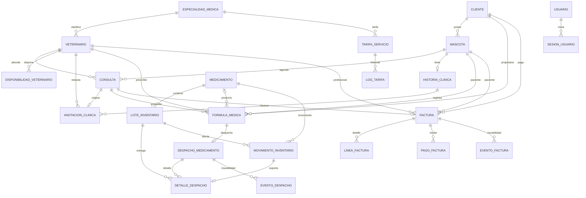

# Entregable 1 — Modelo de datos

## Diagrama entidad-relación

## Relaciones y restricciones

| Relación | Restricción aplicada y propósito |
|---|---|
| Cliente–mascota | FK obligatoria: la mascota siempre tiene propietario. El servicio comprueba propiedad al programar/atender. |
| Mascota/veterinario–consulta | FKs obligatorias. El servicio valida profesional activo, disponibilidad, fecha no pasada y ausencia de solapamientos de 15 minutos para veterinario y paciente. |
| Veterinario–especialidad/disponibilidad | La especialidad puede ser opcional; horarios se guardan por día, rango y estado activo. |
| Mascota–historia | FK con `mascota_id` único: una historia por paciente. Anotaciones múltiples preservan la evolución. |
| Anotación–consulta | `consulta_id` único para impedir duplicar la anotación clínica principal de una atención. |
| Tarifa–log | FK para mantener historial de modificación de valor e IVA, sin perder el precio anterior. |
| Medicamento–lote | FK y unicidad `(medicamento_id,codigo_lote)`. La cantidad disponible se controla por lote. |
| Fórmula–despacho | Un despacho por fórmula (FK única); detalles registran lote, cantidad y movimiento de salida asociados. |
| Factura–consulta | FK única: una consulta no puede facturarse dos veces. Las líneas guardan precio e IVA históricos. |
| Factura–pagos/eventos | FKs conservan abonos y trazabilidad de cambios; facturas anuladas permanecen como historial. |
| Usuario–sesión | FK a usuario y hash de token único; la API valida y permite revocar la sesión. |

Las FKs usan el comportamiento restrictivo predeterminado de MySQL; esto evita eliminar accidentalmente información clínica, pagos y movimientos enlazados. Las entidades no tienen FK de base para algunos valores lógicos (por ejemplo `usuario.veterinario_id`), y la capa de servicios valida esos vínculos.

## Justificación de los cambios

- Se modelaron `disponibilidad_veterinario` y la duración en consulta para construir un calendario real respaldado por datos y comprobar cruces horarios.
- Se separó historia clínica de anotaciones para mantener una historia longitudinal por mascota con múltiples eventos.
- Tarifas y log de cambios hacen configurable el cobro y mantienen auditoría; las líneas de factura guardan los valores aplicados en ese momento.
- Lotes, movimientos, despacho y detalles permiten descontar existencias por lote y justificar cada salida. No se usa solo un número agregado de stock.
- Pagos y eventos se separaron de factura para soportar pagos parciales, anulación trazable y reportes coherentes.
- Usuarios y sesiones respaldan autenticación por perfiles con tokens revocables.

## Script SQL

Ejecuta `backend2026-80869/clinica_schema.sql` en MySQL 8.4. Es idempotente para crear tablas vacías y conserva restricciones referenciales. El arranque del backend configura Hibernate `update` para añadir columnas requeridas por la versión del código. Antes de actualizar una base con datos existentes, crea una copia de seguridad y aplica los cambios sobre una copia de ensayo.
