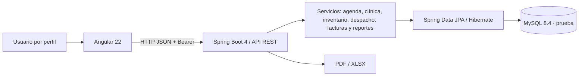

# Clínica veterinaria — entrega técnica

Aplicación full stack con Angular, Spring Boot y MySQL. El esquema se llama **`prueba`**. El frontend administra clientes y mascotas, agenda en calendario, historias y atención clínica, especialidades/tarifas, inventario y despacho, fórmulas, facturación y reportes PDF/Excel.

## Ejecución con Docker Compose (recomendada)

Requisitos: Docker Desktop con Docker Compose v2 y puertos locales 3307, 8080 y 4200 disponibles.

Desde esta carpeta, en PowerShell:

```powershell
docker compose up --build -d
docker compose ps
docker compose logs -f backend
```

URLs:

- Aplicación Angular: http://localhost:4200
- API: http://localhost:8080/clinica/v1
- Swagger UI: http://localhost:8080/clinica/v1/swagger-ui.html
- OpenAPI JSON: http://localhost:8080/clinica/v1/v3/api-docs
- MySQL del contenedor (si se conecta desde Workbench): `localhost:3307`, base `prueba`, usuario `clinica`.

El volumen `clinica_db` conserva los datos entre reinicios. `docker compose down` detiene los servicios sin borrarlos. Para eliminar también los datos locales del contenedor: `docker compose down -v` (acción destructiva).

### Variables locales

Los valores predeterminados de Compose son únicamente para demostración y activan el perfil `dev` para crear la cuenta inicial y datos de demostración. Antes de compartir, define variables en un archivo `.env` local (no lo subas al repositorio): `DB_PASSWORD`, `MYSQL_ROOT_PASSWORD`, `AUTH_BOOTSTRAP_USERNAME` y `AUTH_BOOTSTRAP_PASSWORD`. El usuario inicial se crea si aún no existe. Cambia su clave antes de exponer el servicio a una red pública.

Cuenta local inicial para entrar y crear usuarios por rol: `admin` / `Min2022*`. Es una credencial académica de desarrollo, no una contraseña real ni apta para producción. Los usuarios veterinario, secretaria y despacho se crean desde **Usuarios y perfiles** asignándoles una contraseña local de prueba; no hay cuentas compartidas precreadas.

## Ejecución sin contenedores

1. Instala JDK 21, Maven 3.9+, Node 22+, npm y MySQL 8.4.
2. Inicia MySQL y ejecuta `backend2026-80869/clinica_schema.sql` en el servidor. El usuario configurado debe tener permisos sobre `prueba`.
3. Backend: en `backend2026-80869`, ejecuta `./mvnw spring-boot:run` si el wrapper está presente; de lo contrario `mvn spring-boot:run`. Por defecto usa `localhost:3306`, DB `prueba`, usuario `root`, clave `1234`. Sobrescribe con `DB_HOST`, `DB_PORT`, `DB_NAME`, `DB_USER`, `DB_PASSWORD`; DDL `update` completa/actualiza tablas según entidades.
4. Frontend: en `80869_Laura_Gonzalez_Maicol_Tautiva`, ejecuta `npm ci` y `npm start`. Abre http://localhost:4200. El navegador consume `http://localhost:8080/clinica/v1`.

## Arquitectura



Las validaciones de negocio se ejecutan en backend. La API se sirve bajo `/clinica/v1`; el frontend solicita autenticación y conserva el token de sesión. El diagrama entidad-relación, las reglas y las justificaciones están en [MODELO_DATOS.md](MODELO_DATOS.md), y el script en [backend2026-80869/clinica_schema.sql](backend2026-80869/clinica_schema.sql).

## Módulos y verificaciones

La guía de pruebas manuales, incluida la importación de más de 50 filas y qué capturas guardar para la entrega, está en [EVIDENCIAS.md](EVIDENCIAS.md). Los contratos REST principales están en [API.md](API.md); Swagger documenta los controladores automáticamente.

## Persistencia y seguridad

Las restricciones relacionales usan claves foráneas y unicidad. El inventario y la facturación conservan movimientos/eventos históricos; por eso se recomienda inactivar/anular, no borrar registros ligados. Los tokens se verifican en el backend y se almacenan como hash. El acceso por perfil controla despacho y las acciones se deben probar con cuentas diferenciadas. `ddl-auto=update` facilita esta entrega académica; para producción se recomienda gestionar cambios con migraciones versionadas y secretos fuera del repositorio.
